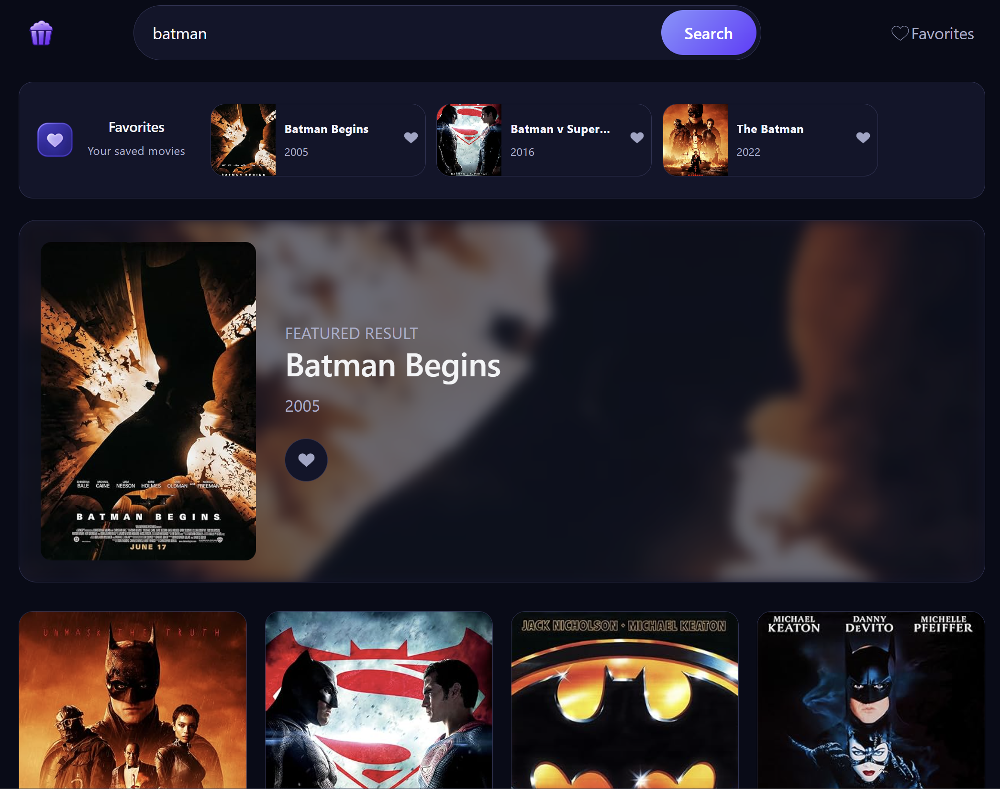

# Movie Explorer

A movie search app built with React, TypeScript and Tailwind CSS, using the OMDb API.
Search for any movie, open its details page, and save favorites that stay after a refresh.

**Live demo:** (https://movie-explorer-zeta-mocha.vercel.app/)



## Features

- **Search** movies by title (press Enter or click Search)
- **Featured result** with a blurred poster backdrop
- **Movie details page** with its own URL (`/movie/:id`), so links can be shared
- **Favorites** that persist after a page refresh (saved in localStorage)
- **Responsive, mobile-first layout**: works from a 375px phone up to large screens
- **Accessible**: fully usable with only a keyboard, visible focus states, labels for screen readers (Lighthouse accessibility score 98–100)
- Loading, error and "no results" states

## Tech Stack

- React 19 + TypeScript
- Vite
- React Router
- Tailwind CSS v4
- OMDb API
- Deployed on Vercel

## How It's Built

- **Routing:** React Router with three pages: search, favorites and movie details.
- **Custom hooks:** `useMovieSearch` and `useMovie` keep data fetching out of the components.
- **Context:** a `FavoritesProvider` shares the favorites list across the app without passing props through every level.
- **Persistence:** favorites are loaded from localStorage on start (lazy initial state) and saved with `useEffect` whenever they change.
- **Reusable components:** `MovieCard` has a `variant` prop (`"grid"` or `"compact"`) so the same component is used for the results grid and the favorites list.

## Getting Started

1. Clone the repository:

```bash
   git clone [https://github.com/AntreasChristoforou/movie-explorer]
   cd movie-explorer
```

2. Install dependencies:

```bash
   npm install
```

3. Get a free API key from [omdbapi.com](https://www.omdbapi.com/apikey.aspx), then create a `.env` file in the project root:

```
   VITE_OMDB_KEY=your_api_key_here
```

4. Start the development server:

```bash
   npm run dev
```

## What I Learned

- Splitting an app into pages with React Router, and reading URL parameters with `useParams`
- Writing custom hooks to reuse data-fetching logic
- Sharing state with Context instead of prop drilling
- Syncing state with localStorage using `useEffect`, and handling broken saved data with try/catch
- Migrating a whole app from plain CSS to Tailwind, including theme colors with `@theme`
- Building mobile-first layouts and testing them at 375px, 768px and 1280px
- Accessibility basics: semantic HTML (`main`, `nav`, `dl`, heading order), labels for icon-only buttons, visible keyboard focus, and testing with Lighthouse
- Deploying a single-page app on Vercel: environment variables and the rewrite rule that fixes 404s on refresh

## Future Improvements

- Keep the search term in the URL (`?q=batman`) so results survive a refresh
- Fallback image when a poster fails to load
- Pagination for long result lists
- Unit and component tests with Vitest and React Testing Library
- Smaller, optimized images for faster loading on mobile

## Tests

Tests use ViteTest and React Testing Library.

​```bash
npm test
​```

What's covered:
- `getPosterUrl` (the poster helper)
- `toggleMovie` (adding, removing, not changing the original list)
- `FavoritesPage` (the empty favorites message)